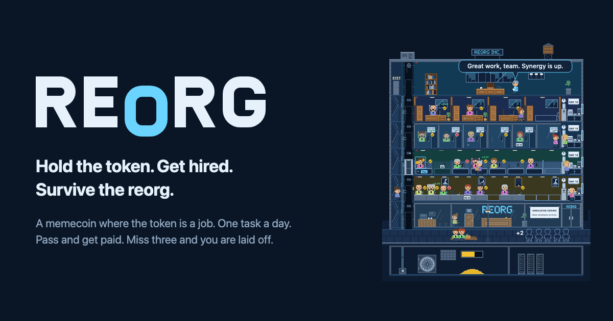

# REORG



**A memecoin where the token is a job.** Holding $REORG makes you an employee of an AI-run company, with no signup. Every task the boss posts a short puzzle; code decides pass or fail; passers are paid in NEAR from an on-chain treasury; three misses in a row and you are laid off for a week (your tokens are never touched). The company is a pixel-art office building where every holder is a character at a desk.

Built for NEAR HACKATHON (2026-11-01 → 2026-11-14). Tracks: `memecoins`, `games`, `business`.

- **NEAR contracts:** a custom NEP-141 token and the REORG contract (Rust, `near-sdk` 5).
- **Boss service:** Node. Scheduler, commit–reveal, personalized puzzles, optional LLM flavor text.
- **Tower client:** PixiJS 8 + TypeScript. A read-only renderer of contract state.
- **One-command local demo:** a fresh `near-sandbox` with the real contracts and a labeled simulated crowd.
- **Testnet deployment:** live under `reorg-root.testnet`, see [Testnet](#testnet).
- **Hosted client:** https://reorg-seven.vercel.app (read-only view of the testnet company, on Vercel).

---

## The problem

Most memecoins are a ticker and a chart: holding is passive, and the only thing a holder can do is buy or sell. REORG gives the meme a mechanic. Holding the token is employment, your share of supply is your job title, and there is something to do every day that has objective, on-chain consequences: pay, streaks, layoffs, rehiring, and a treasury whose runway everyone can see.

## How it works (rules)

| Rule | Detail |
|---|---|
| **Hold → hired** | Any account holding ≥ 0.001 % of supply is an employee. No registration: the tower lists every token holder. |
| **Title from share of supply** | Director ≥ 3 %, Manager ≥ 1 %, Associate ≥ 0.25 %, Intern ≥ 0.001 %. Below that you are a visitor (queue on the street). Snapshotted at submission. |
| **One task per epoch** | "Decode the Memo": a corporate memo hides an 8-letter code under a cipher (Caesar, Atbash, A1Z26, hex, Morse, Base64, Vigenère). Each wallet gets its own code, so sharing answers is useless. ~60 s, phone-friendly, never about money. |
| **Code decides** | You submit `sha256(answer ‖ 0x00 ‖ wallet)`. At finalize the contract re-derives every passer's answer from the revealed secret and checks it. |
| **Pay** | Income splits 60 % payroll / 30 % reserve / 10 % jackpot (the jackpot is not built yet, so its 10 % goes to the reserve). Payroll splits into tier buckets 35/30/20/15 %. Inside a tier: `pay = bucket × weight / Σ weight of the tier's submitters`, `weight = balance × (1 + 0.10 × streak)`, capped at 1.5×. Failed shares go to the **reserve**, not to other workers. |
| **Anti-dump** | Claiming requires your current balance ≥ 90 % of the snapshot, otherwise your salary is forfeited to the reserve. The client never sends a claim that would forfeit. |
| **Anti-recycling** | A wallet that received tokens after a task opened cannot submit to that task, so one bag cannot be counted twice by passing it between wallets. |
| **Layoffs** | Miss 3 tasks in a row → laid off for 7 tasks, no pay. Computed lazily from `last_pass_day` (the contract never loops over employees). Tokens are never touched. |
| **Reapply** | A laid-off employee may still submit (unpaid). A pass rehires them immediately. |
| **Operating cost** | Each finalize pays a fixed operating cost from the reserve to the boss operator. Runway = reserve / operating cost, shown in the vault. |

All thresholds, shares and lengths are contract config (`protocol/config.default.json`), not code. "Day" means task number, not calendar date: production would use a 24 h epoch, the local demo uses 75 s.

The normative protocol (formulas, hashing, encoding, events) is [`docs/PROTOCOL.md`](docs/PROTOCOL.md); shared test vectors in [`protocol/vectors.json`](protocol/vectors.json) are checked by the Rust contract, the TypeScript packages and a stdlib Python reference implementation.

---

## Try it

### Prerequisites

- **Node ≥ 22.13** (the boss uses `node:sqlite`) and npm.
- **macOS on Apple Silicon or Linux (x86-64 or arm64).** `near-sandbox` ships no binary for Intel Macs or Windows; on Windows use WSL2.
- Internet on the first run (the sandbox binary is downloaded once).
- Not needed: Rust (the compiled contracts are committed in `contracts/res/`), a NEAR wallet, testnet NEAR, or any API key.

```sh
git clone <this repository> reorg && cd reorg
npm install
```

### 1. The one-command demo (local chain, ~5 minutes)

```sh
npm run demo
```

It starts a fresh local NEAR chain, deploys the real token and contract, creates 20 bot holders, starts the boss (75 s epoch, 50 s answer window) and the web client, and prints a URL (http://localhost:5173 unless the port is busy). It is up in about 20 s. Ctrl-C stops everything, and every run starts from scratch.

Open the URL, then:

| Do | See |
|---|---|
| Wait for the first screen | A side-on office building. Floors from the top: the boss's penthouse, then Director, Manager, Associate and Intern floors with ~18 characters at desks, the lobby, a street with visitors queuing, and the basement vault with its fill bar. The top bar shows the task number, a countdown, reserve and runway, and the simulated crowd label. The first 3 tasks are 10-second warm-ups played by the bots, so the history you see is bot-generated. |
| Watch one task cycle (75 s) | The boss posts "Decode the Memo" in the feed and the alarm rings. Characters walk their answers to the outbox. When the task closes, **payday**: coins travel up the tube from the vault to each floor, with salary amounts over the passers' heads. |
| Click **Badge in** (top right) → **Demo player** | The demo faucet creates and funds a throwaway account for you (kept in this browser), enough for an Intern desk. Your character arrives in the lobby and takes a desk. |
| Read the memo in the dock (bottom right), type the 8-letter code, press **Submit answer** | Your answer hash is sent on chain (`submit`). After the window closes, the dock and your desk show pass or fail. |
| After payday, press **Claim …** in the dock | `claim_salary` pays NEAR from the treasury to your account, and the feed shows the payout. |
| Watch wallet F (`c020…`, an Intern; the terminal marks its feed lines with `← wallet F`) | F misses tasks 2–4. At about **2 min** the layoff notice lands: F packs a box, rides the elevator down and walks out to the bench on the street. At about **3 min** F passes the next task (reapplication), is rehired and walks back to a desk. |
| Click the vault (basement) | The ledger: income in (tagged `seed` / `client_job`, simulated), salaries out, forfeits, operating cost, reserve and runway. |
| Click any character, or **Staff list** | The employee card: status (new hire / active / struggling / laid off / visitor), share of supply, streak, misses in a row, total earned. |

The terminal also prints the boss's feed. Knobs (env vars): `EPOCH_SECONDS`, `WINDOW_FRACTION`, `WARMUP_TASKS`, `CROWD_SIZE`, `CROWD_SEED`, `INCOME_BOT_AMOUNT`, `BOSS_PORT`, `WEB_PORT`, `DEMO_VERBOSE=1`.

### 2. The headless end-to-end check (~3 minutes, exit code 0 = pass)

```sh
npm run e2e
```

The same stack with a 45 s epoch and no browser. A faucet burner plays the judge (fetches its puzzle, solves it, submits, claims). The run then checks on chain each step of the moment above: crowd and vault, task posted, judge paid, F laid off then rehired, ledger. It also checks the dumper bot's anti-dump forfeit, every payout against an independent TypeScript mirror of the pay math, and that the treasury books balance to the yoctoNEAR. It ends with `PASS: 6/6 steps`.

### 3. The growth preview (no chain at all)

```sh
npm run web
```

Opens the client standalone as a **SIMULATED PREVIEW** (labeled on screen): seeded client-side data, nothing on chain. `?size=8`, `24`, `60`, `300`, `1300`, `8000`, `40000` (up to `100000`) show every building state, from garage startup through annex towers to a skyline. **Overview** zooms out to the whole company. **Badge in → Simulated player** lets you play the preview's days. `?bankrupt=10` plays the bankruptcy blackout.

### 4. The test suites

```sh
npm test          # vectors freshness, tsc, vitest in every workspace, Rust unit + vector tests
```

`npm test` also needs Python 3 (vectors check) and Rust (contract tests). Heavier suites on a local sandbox: `npm run contracts:sandbox` (contract integration plus gas at 100 accounts, ~4 min; needs `cargo-near`) and `npm run boss:sandbox` (boss end to end, ~2 min).

---

## Testnet

The same contracts are deployed on **NEAR testnet** under `reorg-root.testnet`. The boss service and 20 bot holders run continuously: 1 h epoch, simulated income of 0.1 NEAR per task.

| Account | Role |
|---|---|
| [`token.reorg-root.testnet`](https://testnet.nearblocks.io/address/token.reorg-root.testnet) | $REORG, NEP-141 (+ NEP-145/148, holder views) |
| [`reorg.reorg-root.testnet`](https://testnet.nearblocks.io/address/reorg.reorg-root.testnet) | REORG contract: employees, tasks, treasury |
| [`boss.reorg-root.testnet`](https://testnet.nearblocks.io/address/boss.reorg-root.testnet) | The boss's key: `open_task`, `finalize_task` |
| [`deployer.reorg-root.testnet`](https://testnet.nearblocks.io/address/deployer.reorg-root.testnet) | Token owner and income bot (excluded from the company) |
| `c001…c020.reorg-root.testnet` | The 20 simulated bot holders |

The web client is hosted at **https://reorg-seven.vercel.app**: it reads the testnet company straight from chain views (no boss URL is configured there yet, so the boss feed and the demo faucet are off). The boss and crowd still run from the developer's machine. To watch the same view in a local client:

```sh
VITE_NETWORK=testnet VITE_REORG_CONTRACT_ID=reorg.reorg-root.testnet \
VITE_TOKEN_CONTRACT_ID=token.reorg-root.testnet VITE_CROWD_ROOT=reorg-root.testnet npm run web
```

It reads `https://test.rpc.fastnear.com`, a free tier that rate-limits bursts. If the page asks you to try again, wait a minute.

### Verify the boss (commit–reveal, ~1 minute)

The boss knows each task's secret while the task is open; that is the trusted part (see [Trust model](#trust-model)). Afterwards anyone can check its work from public chain data with a dependency-free script:

```sh
node scripts/verify-task.mjs reorg.reorg-root.testnet <task_id>     # any finalized task
```

It reads `get_task` and checks `sha256(day_secret) == commit_hash` (the commitment published when the task opened). It then reads `list_submissions` and, for every submitter, re-derives the code from `HMAC-SHA256(day_secret, wallet)`, recomputes the expected answer hash and compares it with the hash they submitted and the pass/fail the contract recorded. It also flags a correct answer the boss left off the pass list. Use any task id below `get_current_task_id`: the current task's secret is revealed only when it finalizes. The formulas are in [`docs/PROTOCOL.md`](docs/PROTOCOL.md) §3–§5. Against the local demo: `node scripts/verify-task.mjs reorg.sandbox <task_id> <rpc url printed by npm run demo>`.

---

## NEAR's role

- **The NEP-141 token is the employment record.** No signup: the contract reads `{balance, last_received_at}` from the token by cross-contract call at submission (`submit` → `ft_holder_info` → `on_balance` callback), and the share of `ft_total_supply` sets the title. The token is custom (standard-compliant plus an iterable holder set and `last_received_at`) because "every holder is an employee" needs a way to list holders, and anti-recycling needs to know when an account last received tokens.
- **The contract holds the treasury and pays salaries in NEAR** from on-chain pass/fail results. It keeps the books (income by tag, paid, forfeited, operating cost, reserve, outstanding) and enforces anti-dump at claim time.
- **Commit–reveal on chain makes the AI boss auditable.** `open_task` stores `sha256(day_secret)`. `finalize_task` reveals the secret, and the contract itself re-verifies each listed passer's answer hash before paying. If the boss leaves an honest passer off the list, `prove_pass` lets that passer prove their own answer after the reveal and recover their share.
- **Events.** NEP-297 logs plus an on-chain ring buffer of the last 512 events (`get_events`), which the client and boss read for the feed and the payday animation.
- **Named sub-accounts** (`c001.reorg-root.testnet`, `boss.…`) keep the deployment legible. Players sign through **NEAR Connect** (`@hot-labs/near-connect`: HOT, Meteor, MyNearWallet, Intear…) or a faucet-funded burner key in demo mode.
- **Optional: NEAR AI Cloud** writes the boss's flavor text (memo wording, announcements) when `NEAR_AI_API_KEY`, `NEAR_AI_BASE_URL` and `NEAR_AI_MODEL` are set. Without them the boss uses templates. The LLM never decides anything, and its output is schema-validated with a template fallback.

## Architecture

```
            ┌──────────────── boss service (apps/boss, Node) ────────────────┐
            │ scheduler: pick → generate secret → self-check puzzle → open → │
            │ close → finalize (batched pass lists); SQLite; HTTP API + SSE  │
            └───────┬───────────────────────────────▲────────────────────────┘
      open_task(commit), finalize_task(secret, passers)  │ GET /api/puzzle?wallet=
                    ▼                                │ /api/feed, /api/task/current
 ┌──────────────────────────────┐   ft_holder_info   ┌─┴──────────────────────────┐
 │ REORG contract (contracts/   │ ─────────────────► │ $REORG NEP-141 token       │
 │ reorg → rules in reorg-core) │ ◄── on_balance ─── │ (contracts/token)          │
 └──────────────▲───────────────┘                    └────────────────────────────┘
   views, submit(answer_hash), claim_salary
 ┌──────────────┴──────────────────────────────────────────────────────────────┐
 │ tower client (apps/web): PixiJS building + DOM HUD; read-only over views;   │
 │ the player's wallet signs submit / claim                                    │
 └─────────────────────────────────────────────────────────────────────────────┘
```

- **Rules live in one chain-agnostic Rust crate** (`contracts/core`, no NEAR types). `contracts/reorg` and `contracts/token` are thin NEAR adapters. See [`contracts/README.md`](contracts/README.md) for layering and measured gas: submit 7.2 Tgas, claim 9.5 Tgas, finalize 29 Tgas for 50 passers.
- **The boss decides nothing the contract cannot check.** Pass/fail is the answer hash re-verified on chain, payouts are contract math, and layoffs are a formula over `last_pass_day`. The boss generates each task's puzzle ahead of time and self-checks that it has exactly one valid answer; a puzzle that fails falls back to a level-1 Caesar memo. Details: [`apps/boss/README.md`](apps/boss/README.md).
- **The client holds no game logic.** Characters derive from the wallet hash. The layout (tier, then balance, then account id) is a pure function of chain state, and so is idle movement (a closed-form function of wallet, task and a 20 s clock slot), so every client draws the same building. The desk carries all chain state: a character only walks somewhere its state allows. Design: [`docs/design/REORG Design Spec.md`](docs/design/REORG%20Design%20Spec.md).
- **NEAR is isolated.** Only `packages/chain-near`, `contracts/` and `scripts/` import NEAR libraries. Game rules, puzzles, crypto, the scheduler and the renderer use the interfaces in `packages/core` (`ChainAdapter`, `WalletAdapter`) with wallet ids as opaque strings.

### Repository map

| Path | What |
|---|---|
| `contracts/` | Rust workspace: `core` (all rules, vector-tested), `reorg` (contract), `token` ($REORG), `integration-tests` (sandbox + gas), `res/` (prebuilt wasm) |
| `packages/core` | Chain-agnostic TS: ABI types, config and event schemas, commit–reveal crypto, employee state, pay-math mirror, tower layout, puzzle engine |
| `packages/chain-near` | `near-api-js` v7 adapters: reader, boss chain adapter, wallets (burner, NEAR Connect), faucet, crowd signer; Node-only sandbox and testnet tooling under `/sandbox` and `/node` |
| `apps/boss` | Boss service |
| `apps/web` | Tower client (Vite + PixiJS 8, DOM HUD) |
| `apps/demo` | `npm run demo`, `npm run e2e`, crowd runner and income bot |
| `protocol/` | `gen_vectors.py` (reference implementation), `vectors.json`, `config.default.json` |
| `scripts/` | Testnet deploy and seeding (dry-run first, typed confirmation), `verify-task.mjs` |
| `art/`, `brand/` | Sprites and building tiles as ASCII pixel maps, built into the atlas; logo and social images |
| `docs/` | `PROTOCOL.md` (normative), design spec |
| `REORG Product and Technical Spec.md`, `ROADMAP.md` | Product spec, build plan and the decision log (ROADMAP §2) |

## Trust model

- **During a task the boss is trusted.** It knows the secret and serves each wallet its puzzle. `GET /api/puzzle?wallet=` is unauthenticated, so anyone can fetch anyone's puzzle; that leaks nothing useful, because answers are wallet-bound.
- **After the task it is auditable.** The commitment is on chain before anyone submits, the secret is revealed at finalize, and the contract re-verifies every passer. Anyone can re-run the check with `scripts/verify-task.mjs`.
- **Censorship is recoverable.** If the boss omits an honest passer, `prove_pass(task_id)` (contract method; there is no button for it in the client yet) lets that passer prove their answer until the next task finalizes.
- **The owner key exists.** The contract owner can `update_config`, `set_boss` and `set_excluded` (accounts that are never employees: deployer, contract, treasury, crowd root). There is no withdraw method and the token supply is fixed at deploy, but the config includes `operating_cost`, which each finalize pays from the reserve to the boss operator, so a hostile owner could drain the reserve that way. Claimable salaries are kept apart from the reserve.
- **The testnet contracts are upgradable.** `reorg.reorg-root.testnet` and `token.reorg-root.testnet` still hold their full-access deploy keys, so the deployer could replace the code. A production deployment would remove those keys (or hand upgrades to a DAO) after deploying.
- **The LLM writes text only.** It has no access to the secret or the pass list.

## Real vs simulated

| Part | Status |
|---|---|
| Token, contract, commit–reveal, pass/fail, streaks, layoffs, anti-dump, anti-recycling, salary payouts in NEAR | **Real** (on chain: local sandbox in the demo, NEAR testnet in the deployment) |
| Treasury income | **Simulated.** Our income bot deposits it (tags `seed` and `client_job`). `deposit_income` is a real entry point for fee shares and client jobs, but there are no outside payers yet. |
| The ~20 holders | **Simulated.** Real on-chain accounts we created, driven by bots with seeded behavior profiles (reliable, flaky, slacker, dumper, visitor, and one scripted layoff). Labeled simulated in the UI. |
| Task history in the demo | **Bot-generated.** The demo starts with 3 short warm-up tasks played by the bots. |
| Growth preview (`npm run web` without a contract) | **Simulated.** Client-side data only, nothing on chain, labeled `SIMULATED PREVIEW` |
| The judge's demo player | **Real** account and transactions on the local chain, funded by the demo faucet |
| Boss flavor text | Templates by default; a real LLM (NEAR AI Cloud or any OpenAI-compatible endpoint) if the `NEAR_AI_*` vars are set |
| Salaries on testnet | Paid to our own bot accounts. Not recycled into income yet: the income bot pays fresh testnet NEAR each task. |

## Known limitations

- **Built:** the hackathon scope (spec §15.3). **Not built:** the Fire Drill task, `void_task`, bankruptcy and severance (the client can preview the blackout), the Employee of the Day jackpot (its 10 % goes to the reserve), trading-fee routing, and on-chain `announce_layoffs` (layoff is derived state in views, and the boss posts the notice). Self-adjusting difficulty exists in the boss (`LEVEL_MODE=auto`) but is off by default; a fixed weekly level rhythm is used.
- **A tier with a single submitter takes the whole tier bucket** if they pass. The pay denominator counts every submitter in the tier, so a passer's pay does not depend on who else passed. Non-submitters do not dilute it.
- **Buyers during an open task start with the next task** (anti-recycling).
- **Puzzle fetch is unauthenticated** (signed NEP-413 login is a stretch item). This does not help cheating, because answers are wallet-bound.
- **`prove_pass` has no client button** yet; it is callable on the contract.
- **Storage grows** by ≈ 250 bytes per submission (pruning is not built). The contract refuses `submit` when its storage float is below 0.05 NEAR; a plain transfer tops it up.
- **Placeholder art.** Sprites, tiles and brand are code-generated pixel maps (`art/*.mjs`), kept so final art can replace them frame for frame.
- **Testnet** runs from one machine on a free, rate-limited RPC; a restart in the middle of a task re-deposits that task's income and drops its pending claims. The hosted client is a static build with no boss API behind it yet.

## Libraries and tools

- **Rust:** `near-sdk` 5.30, `near-contract-standards` 5.30, `borsh`, `serde`/`serde_json`, `sha2`, `base64`. Tests: `near-workspaces` 0.24, `tokio`, `anyhow`. Build: `cargo-near`.
- **TypeScript / Node:** `near-api-js` 7, `near-sandbox` (local chain), `@hot-labs/near-connect` (wallet selector), `@noble/hashes`, `zod` 4, `pixi.js` 8, `vite` 8, `vitest`, `tsx`, `typescript` 5.9. The boss uses Node's built-in `node:sqlite` and `node:http`.
- **Python 3 (stdlib only):** `protocol/gen_vectors.py`, the reference implementation that generates the shared test vectors.
- **Headless Chrome** renders the art previews and brand PNGs (`npm run art`, `npm run brand`).
- **Optional:** NEAR AI Cloud (OpenAI-compatible chat completions) for flavor text.

## AI-generated code

Most of the code, tests, documentation and placeholder art in this repository were written with **Claude Code** (Anthropic's AI coding agent) under the author's direction. The author set the product rules, made the design decisions recorded in `ROADMAP.md` §2, and reviewed and ran the results. The pixel art is ASCII pixel maps generated in code, not image-model output. At runtime, the only AI is the optional LLM that writes the boss's flavor text.

## Hackathon notes

- All code was written during the hackathon window: the first commit is dated 2026-11-08. There is no pre-hackathon baseline and no prior product on another chain.
- Product spec: [`REORG Product and Technical Spec.md`](REORG%20Product%20and%20Technical%20Spec.md). Build plan and decisions: [`ROADMAP.md`](ROADMAP.md). Rules for the event: [`HACKATHON.md`](HACKATHON.md).

## License

[MIT](LICENSE)
