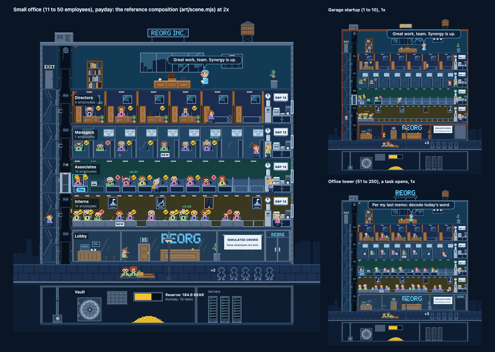

# REORG game art

> **TODO(art): placeholder art.** Everything here is drawn from code, to unblock the client and the brand kit. Replace it with the final art before launch. Keep the frame names, layers and `RIG` (in `sprites.mjs` and `building.mjs`), or change the renderer and Design Spec §4–§5 together, so new art drops into the building without code changes. The brand icon and social images reuse these sprites and `scene.mjs`, so run `npm run brand` after `npm run art`.

## What is here

| File | What |
| --- | --- |
| `pixmap.mjs` | The legend (ASCII character to layer and color), map helpers, a `Grid` canvas for the big tiles, two pixel fonts for signage |
| `sprites.mjs` | Characters, the boss, props and effects as ASCII pixel maps; the rig (`RIG`): poses, per-frame hair offsets and hand points, attach points, animations |
| `building.mjs` | Building tiles (roadmap A-01) and `RIG.building`: geometry, per-tier room anchors, placements for every band |
| `scene.mjs` | A whole building composed from the atlas frames as SVG: the reference for how the client stacks the tiles (roadmap W-05), and the source of `building.png` and the brand images |
| `palette.mjs` | Blueprint tokens and building tokens (Design Spec §6) and the sprite-only shades |
| `build.mjs` | `npm run art`: validates the rig, writes the atlas, its JSON and the review images |
| `lib.mjs` | PNG encoder, pixel grid to SVG, SVG to PNG through headless Chrome |
| `characters.png`, `characters.json` | The atlas (512 px wide, RGBA), in Pixi spritesheet format, with `meta.rig` |
| `preview.png` | Every frame enlarged, grouped |
| `building.png` | The Small office at payday (2×), the Garage startup (1×), the Office tower as a task opens (1×) |
| `anim.html` | Every animation playing from the atlas, tinted, with hair. Self-contained; open it in a browser. `?t=<ms>` freezes the clock |

Edit the `.mjs` sources, never the outputs. `npm run art` fails if the rig names a frame that does not exist.

## The cast (A-02)

**Employees.** 12 px wide; standing frames are 20 tall, seated frames 15 (`RIG.character`; ROADMAP D23). The head sits in rows 0 to 8. The boss keeps the earlier 16 px head and legs in an 18 × 28 frame, so he stands a head taller. A pose that moves the head says so in `RIG.frames[frame].headY` (and `headX`), and the hair moves with it: the walk bobs up 1 px on its passing frames, the slump sinks 1 and 2 px. The far leg is a shade darker than the near leg, so a stride reads.

| Frames (animation) | Use | Design Spec |
| --- | --- | --- |
| `emp.sit.front` | Seated, facing out: between tasks, new hire | §5.3 |
| `emp.sit.land` | One squashed frame on sitting down | §14.1 |
| `emp.type.0`–`.1` (`emp.type`) | Seated in profile, typing, while a task is open | §5.4 Working |
| `emp.cheer.0`–`.1` (`emp.cheer`, once) | Arms up: passed, paid | §14.3 Results, Payday |
| `emp.slump.0`–`.1` (`emp.slump`, once) | Head down: missed | §14.3 Results |
| `emp.stand.front`, `emp.stand.side` | Waiting, riding the elevator, at the printer or the window | §5.2 |
| `emp.walk.0`–`.3` (`emp.walk`, `emp.run`) | Walking at 8 fps; running is the same frames at 16 fps | §5.5 |
| `emp.carry.0`–`.3` (`emp.carry`) | The layoff walk-out with the box and the desk plant | §14.3 Layoff |
| `emp.climb.0`–`.3` (`emp.climb`) | Climbing stairs, knee up | §4.4 |
| `emp.drink.0`–`.1` (`emp.drink`) | Cup at the chest, then at the mouth: cooler and coffee | §5.6 |
| `emp.chat.0`–`.1` (`emp.chat`) | Talking hand: water-cooler chats (one partner mirrored) | §5.6 |
| `emp.bench.0`–`.1` (`emp.bench`) | Laid off, on the street bench, `prop.box.full` beside | §4.5 |
| `emp.visitor`, `.1` (`emp.visitor.shuffle`) | Visitor in the sidewalk queue: outline only, never filled, no hair | §4.5 |
| `emp.sit.side`, `emp.stretch.0`–`.1` | P1 idles at the desk: thinking, stretching | §5.2 |
| `fx.sweat`, `fx.flame.<1-3>.<0-1>` | P1: struggling; flame aura per streak milestone | §5.4 |

Carried paper: `prop.paper` at the frame's hand point, `RIG.frames[frame].hand` (stand, walk and climb frames). Profile frames face right; mirror with `scale.x = -1`.

**The boss.** 18 px wide, accent blazer, silver hair, lanyard, mug. Front frames carry the face from the latest pass rate (§17.1): `boss.smug` (90% and up), `boss.smile` (50 to 89%), `boss.twitchy` (below 50%, or nobody submitted). Profile frames: `boss.stand.side`, `boss.walk.0`–`.3` (pacing with the mug), `boss.point` (the layoff), `boss.sip`.

**Hair.** Styles `short`, `long`, `bun`, `curly` and `none`, each in a front and a side view; style and color from the wallet hash (`RIG.tint`, `RIG.hairStyles`).

**Props and effects.** Chairs (standard and executive, front and side), `prop.monitor.<off|on|flash>` and the interns' `prop.laptop.<off|on|flash>`, `prop.paper` (the submitted sheet, stamped), `prop.box` (the laid-off desk), `prop.box.full`, `prop.plant` (carried on promotion), `prop.coin.0`–`.3` and `prop.coin.land`, `fx.dot.pass` and `fx.dot.miss` (a check and a cross, so meaning never rests on color alone), `prop.sheets.1`–`.6` (the outbox stack), `prop.tape` (the crowd sign's corners).

## The building (A-01)

All geometry is in `RIG.building` (sprite pixels, Design Spec §4.2): the building is 380 wide = outer wall 4 + stairs 20 + tube 4 + elevator shaft 20 + rooms 288 + amenity bay 40 + outer wall 4. A floor is 48 tall plus a 4 px slab; feet stand on the slab's first row; desk tops are at row 38. Rooms are 48 / 32 / 24 / 16 wide, 6 / 9 / 12 / 18 per floor (must match `ROOMS_PER_FLOOR` in `packages/core/src/tower.ts`).

| Group | Tiles |
| --- | --- |
| Shell, per state (§12.2) | `shell.<garage\|office\|tower>.wall` (tiles down the outer walls), `.window` (the right wall's window, the bay's window point), `.slab`, `.parapet`, `.front` (the lobby's street front); signs `sign.garage` (cardboard), `sign.office` (painted), `sign.tower` (lit letters on a truss); `roof.tank`, `roof.machine` |
| Core (§4.4) | `core.stairs` (two flights and a landing per floor), `core.stairs.top`, `core.shaft`, `core.shaft.top`, `core.tube`, `.outlet`, `.cap`, `.foot`, `core.cab` with `core.cab.door.0`–`.2` over the riders, `core.indicator.<off\|up\|down>` |
| Back wall | `wall.window`, `wall.window.big`, `wall.poster.0`–`.2`, `wall.clock` with `wall.clock.hand.0`–`.7` (the task countdown), `wall.whiteboard` (the task number is drawn on it), `wall.board.small`, `wall.alarm.<off\|on>`, `wall.lamp` |
| Rooms (§4.3) | `room.<tier>.back`, `.front`, `.empty` for directors (private office, door swung open), managers (glass front), associates (cubicle), interns (one seat of the long table); `room.directors.wall`; anchors in `RIG.building.rooms` |
| Bay, lobby, street (§4.5) | `bay` (cooler, printer and outbox tray, coffee machine), `lobby.cafe`, `.stool`, `.table`, `.door.hr`, `.reception` (the bell nobody answers), `.logo`, `.plant`, `lobby.door.glass.0`–`.2`, `lobby.rollup.0`–`.2` (garage), `street.pavement`, `.bench`, `.lamp` |
| Basement, penthouse (§4.6) | `vault.door`, `vault.pile.0`–`.5`, `vault.bar` (the fill is drawn into it), `vault.boxes`, `server.rack`, `server.rack.stalled`; `pent.desk`, `pent.shelf`, `pent.orgchart` |
| Backdrop | `sky.skyline`, tiles horizontally behind the street line; `sky.skyline.lit` (night) |
| Later states and surroundings (W-15, §12.2) | Shell tiles for `skyscraper` and `megacorp`; `sign.skyscraper` and `sign.megacorp` (LED tickers reading $REORG), `roof.antenna`, `roof.helipad`; vault art per state in `RIG.building.states[].vault` (`vault.cashbox`, `vault.safe`, `vault.door`, `vault.walkin`, `vault.double`); `sky.blocks` (+ `.lit`), `sky.cloud.0`–`.1`, `sky.blimp` (the panel carries the boss's line); `surr.fence`, `surr.tree`, `surr.car.0`–`.2`, `surr.parking`, `surr.cart`; `twin.facade` (+ `.lit`), `twin.parapet`, `twin.bridge`; placements in `RIG.building.surroundings` |
| Ceremonies (W-15, §12.3, §14.3) | `build.scaffold`, `build.crane.mast`, `.jib`, `.hook`, `build.beam`, `build.ribbon` (+ `.half`), `build.forlease`; `sign.closed` for bankruptcy; geometry in `RIG.building.construction` |

**The street.** The sidewalk is the band below the lobby, in front of it: street characters stand on `RIG.building.street.standY` and overlap the lobby's street front a little, which reads as standing outside a raised lobby. Leaving means walking out of the doors in the bay and down onto the sidewalk (toward the viewer); the visitors queue under the doors, the bench and the lamp stand to the left.

**Translucent pixels.** Glass seen face-on (the managers' glass fronts, the lobby's street front and doors) and its highlight streaks are translucent in the atlas (`~` and `^` in the legend), so the people behind them stay visible.

## How the renderer uses the atlas

- A character is up to three sprites from the one atlas, so nothing is drawn per frame. The frame name (`emp.sit.front`) is the fixed-color layer. `emp.sit.front#shirt` has the same size and anchor; it is grayscale and tinted with the body token. The hair frame (`hair.<style>.<view>`, view from `RIG.frames[frame].view`) is grayscale and tinted with the hair color; place it at the character frame's top-left plus (`headX`, `RIG.hair[style][view].y + headY`). Stack them base, shirt, hair. Frames with no `RIG.frames` entry (visitors) get no hair.
- Anchor characters at the bottom center. Seated frames end at the desk top: draw the room's back tile, the chair (`RIG.attach.chair*`), the character, then the room's front tile, then the monitor and the desk overlays at the room anchors.
- A floor is drawn back to front as in Design Spec §4.1; `scene.mjs` is a working example of the whole stack, band by band. Static layers (shell, back wall, room tiles) can be cached per floor; monitors, overlays, the clock hand and the doors change and stay separate sprites.
- Scale with nearest-neighbor filtering at whole multiples of the device pixel (`TextureStyle.scaleMode = 'nearest'`). On phones the camera fits the 380 px building width below 1× (Design Spec §10), which is not a whole multiple; use linear filtering at that zoom level.
- Animations have 8 frames or fewer (§14.4). One-shot animations carry `loop: false` in `RIG.animations`. The alarm pulses three times at 4 fps, under the three-flashes-per-second limit (§11).
