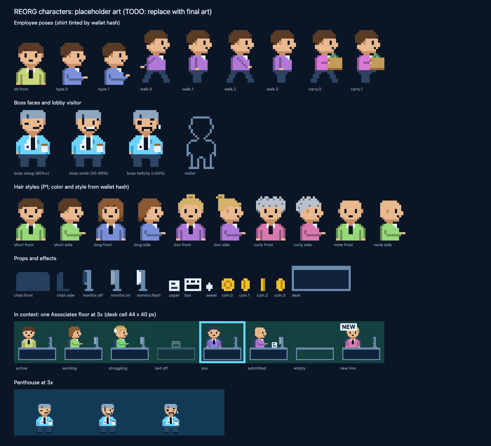

# REORG game art

> **TODO(art): placeholder art.** Everything here was drawn from code to unblock the client and the brand kit. Replace it with the final character art before launch. Keep the frame names, sizes, layers and `RIG` in `sprites.mjs` (or update the renderer and Design Spec §5 together), so new art drops into the tower without code changes. The brand icon and social images reuse these sprites, so run `npm run brand` after `npm run art`.

## What is here

| File | What |
| --- | --- |
| `sprites.mjs` | Every sprite as an ASCII pixel map, plus the rig: poses, animations, tint layers, attach points |
| `palette.mjs` | Blueprint tokens (Design Spec §6) and the sprite-only shades |
| `build.mjs` | `npm run art`: writes the atlas, its JSON and the preview sheet |
| `lib.mjs` | PNG encoder, pixel grid to SVG, and SVG to PNG through headless Chrome |
| `characters.png`, `characters.json` | The atlas, in Pixi spritesheet format, with `meta.rig` |
| `preview.png` | Every frame enlarged, a sample floor and the penthouse, for review |

Edit `sprites.mjs`, never the outputs.

## The cast

**Employees.** 16 px wide; heads sit in rows 0 to 11 of every pose so hair lines up without offsets.

| Frame | Use | Spec |
| --- | --- | --- |
| `emp.sit.front` | Seated, facing out: between tasks, new hire | §5 Active, New hire |
| `emp.type.0`, `.1` | Turned to the monitor, typing (animation `emp.type`) | §5 Working, §14.3 Task opens |
| `emp.walk.0`–`.3` | Rehire walk-in (animation `emp.walk`) | §14.3 Rehire |
| `emp.carry.0`, `.1` | Layoff walk-out with a box and a desk plant (animation `emp.carry`) | §14.3 Layoff |
| `emp.visitor` | Lobby visitor: outline only, never filled | §4 Lobby |
| `fx.sweat` | Struggling (P1) | §5 Struggling |

Profile frames face right. Mirror with `scale.x = -1` to face left.

**The boss.** 18 px wide, standing, accent blazer, silver hair, a lanyard, and a coffee mug. Three faces from the latest pass rate (Design Spec §17.1): `boss.smug` (90% and up), `boss.smile` (50 to 89%), `boss.twitchy` (below 50%, or nobody submitted).

**Props.** `prop.chair.front` and `.side`, `prop.monitor.off`, `.on` and `.flash` (submission), `prop.paper` (submitted), `prop.box` (laid-off desk), `prop.coin.0`–`.3` (animation `prop.coin`, for payday pipes and the claim pop), and `prop.desk`, a reference only: the renderer draws desks at the floor's width, using the shape in `deskRows()`.

**Hair (P1).** Styles `short` (the P0 default), `long`, `bun`, `curly` and `none`, each in a front and a side view. The style and color come from the wallet hash (`RIG.tint`).

## How the renderer uses the atlas

- A character is up to three sprites from the one atlas, so nothing is drawn per frame. The frame name (`emp.sit.front`) is the fixed-color layer. `emp.sit.front#shirt` has the same size and anchor; it is grayscale and tinted with the body token. The hair frame (`hair.short.front`, or `.side` for profile poses) is grayscale and tinted with the hair color; place it at the character frame's top-left, moved down by `RIG.hair[style][view].y` (negative means above). Stack them base, shirt, hair.
- Anchor characters at the bottom center. Seated frames end at the desk top: draw the chair, then the character, then the desk front.
- Attach points (`RIG.attach`) place the sweat drop and the chair.
- Scale with nearest-neighbor filtering at whole multiples of the device pixel (`TextureStyle.scaleMode = 'nearest'`). The 70% phone scale (Design Spec §10) is not a whole multiple; use linear filtering at that zoom level.
- Animations have 8 frames or fewer (§14.4).
