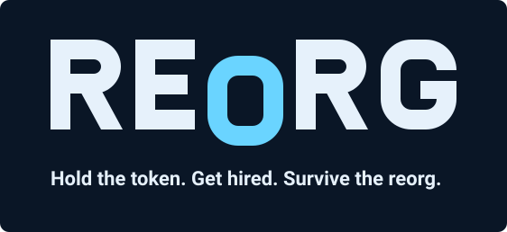

# REORG brand kit

*Reorg Inc. Ticker: $REORG. Hold the token. Get hired. Survive the reorg.*

> **TODO(art): placeholder brand.** The wordmark, icon and social images are stand-ins drawn from code. Replace them with the final brand art before launch, and before any public post or token deploy that bakes the icon into on-chain metadata (the token `icon` is set at init). The characters come from [`art/`](../art/README.md), which is placeholder art too.

This folder has the logo, icon, token icon and social images. All of them come from `build.mjs`, which draws them from code in the Blueprint palette, using the sprites and the building composition in `art/` (`art/scene.mjs`). Change the script, not the outputs, and run `npm run brand` again; it needs Chrome to write the PNGs (set `CHROME=/path/to/chrome` if it is not installed in the usual place). Colors, type, voice and the rules against generic design are in [`docs/design/REORG Design Spec.md`](../docs/design/REORG%20Design%20Spec.md) §2, §6, §7 and §13. That spec wins where this page disagrees with it.

## The mark

**Wordmark.** The game's own logo: the `lobby.logo` sprite from `art/building.mjs`, the pixel REORG that signs the lobby wall and sits in the client's top bar (spec §3). It is drawn in sprite pixels (59 × 15, scaled 8×) as paths, so it needs no font and stays crisp at every size. It is accent-colored with its 1 px accent-shade drop shadow, and the accent is the only decoration (spec §2). Because it is read from the sprite, the brand cannot drift from the UI: change the sprite, run `npm run brand`.

- Use it on navy (`#0a1626`) or the panel color (`#11233a`). The accent is too faint on white or photos, so there use `reorg-lockup.svg`, which has its own navy plate.
- Keep it in the accent with its shade. Don't recolor it, add a second accent, or smooth the pixels.
- Leave clear space of at least one letter's width on every side. The smallest size is 59 px wide (1 px per sprite pixel).
- No gradients, glows, outlines, or tilt (spec §13.1). The built-in 1 px shade is part of the sprite, not an added shadow.

**Icon.** The boss, smug, from the chest up, on navy: silver hair, the accent blazer, a lanyard and a coffee mug. It is the `boss.smug` sprite from `art/sprites.mjs`, drawn in sprite pixels (a 24-unit viewBox), so it stays crisp at every size. The face sits inside the inscribed circle, so wallets that crop token icons to a circle keep it.

## Files

| File | Use |
| --- | --- |
| `logo/reorg-wordmark.svg` | Wordmark on transparent, for dark backgrounds |
| `logo/reorg-lockup.svg`, `.png` | Wordmark and tagline on a navy plate. The README header; works on GitHub light and dark |
| `icon/reorg-icon.svg`, `reorg-icon-512.png` | App icon with rounded corners |
| `icon/favicon-32.png`, `apple-touch-icon-180.png` | Web client favicon and home-screen icon |
| `icon/site.webmanifest` | Web app manifest (name, theme and icons), served by the client |
| `icon/reorg-icon-square.svg` | Full-bleed square, for places that apply their own mask |
| `icon/token-icon.svg`, `token-icon.datauri.txt` | NEP-141 `icon` metadata: a 64 px square SVG, about 2.2 KB as a data URI (one path per color). Pass the contents of the `.txt` as `metadata.icon` when initializing the token |
| `social/og-card.png` | 1200 × 630 link preview (`og:image`, `twitter:image`) |
| `social/x-avatar-400.png`, `x-banner.png` | Profile picture and 1500 × 500 header |

**Wired into the client** (`apps/web`): `vite.config.ts` serves everything in `icon/` at the site root (favicons, `reorg-icon.svg`, `site.webmanifest`) and serves and emits `social/og-card.png` as `/og-card.png`; `index.html` links them and sets the description and the Open Graph and Twitter tags. Link crawlers need absolute URLs, so `og:image`, `og:url` and `twitter:image` are only injected when `VITE_PUBLIC_URL` is set (the public site address, no trailing path); there is no guessed default. The top bar and badge use the `lobby.logo` atlas frame, not these files.

The social images show the game's building (`art/scene.mjs`, the payday sample moment, including its SIMULATED CROWD sign), not live state: the whole building on the OG card, the four tier floors on the X banner. Text on the social images is set in the system UI font and baked into the PNGs; the SVG versions depend on the viewer's fonts, so share the PNGs.

## Palette (from spec §6)

| Role | Token | Hex |
| --- | --- | --- |
| Background | Background | `#0a1626` |
| Surface | Panel | `#11233a` |
| Text and the wordmark | Ink | `#e6f1fb` |
| Secondary text | Muted | `#8fa6bf` |
| The logo, the boss, the player, signage | Accent | `#6ad4ff` |
| Text on the accent | Button text | `#0a1626` |
| Money | Coin | `#f2c230` |

Body colors and floor tints are in spec §6. Never put the accent on a light background: its contrast there is too low.

## Voice

Write in the boss's voice: a passive-aggressive executive who is upbeat about bad news. Use short sentences and put buzzwords in on purpose. Never be cruel to a real person, and never give money advice. Copy states rules; it never tells anyone to buy or sell. The banned words and the copy table are in spec §13.
